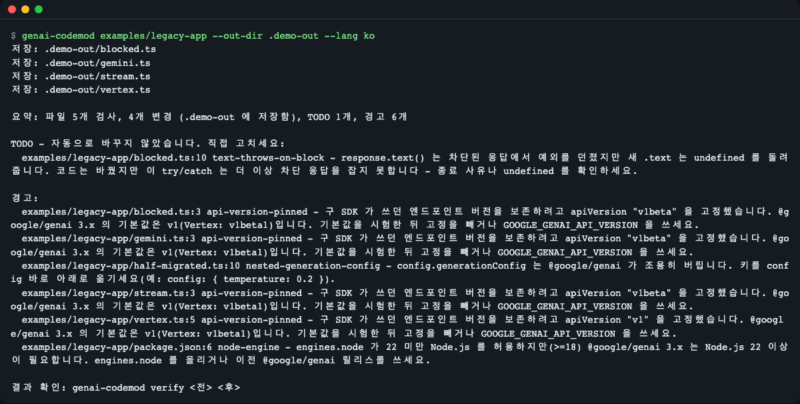
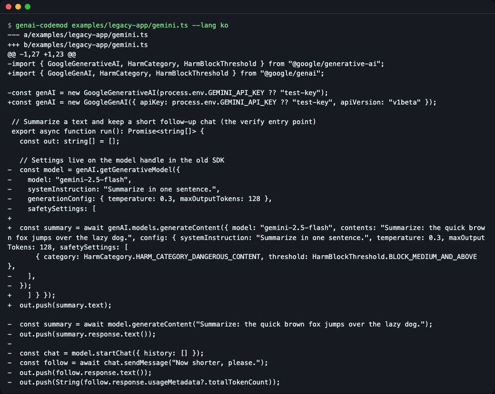
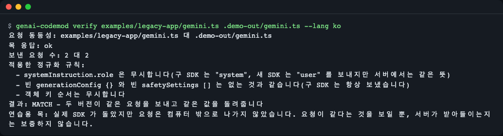
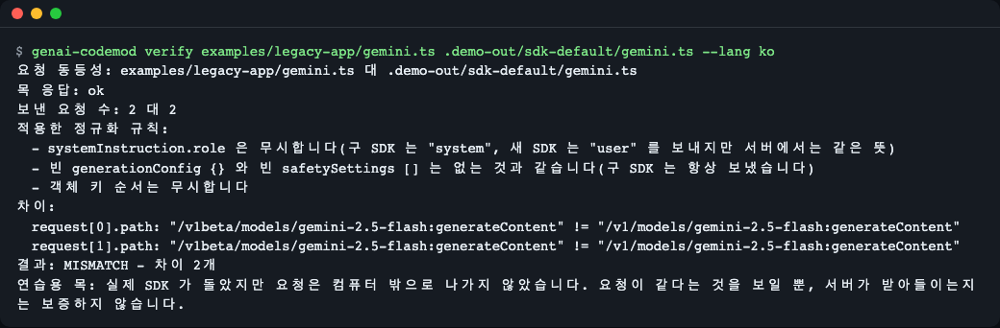
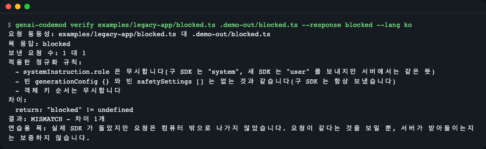
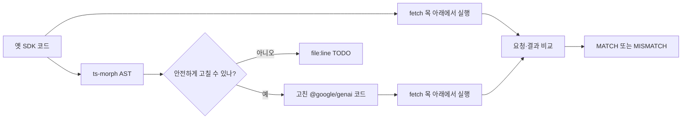

# genai-codemod

[English](README.md) | **한국어**

지원이 끝난 Gemini JS SDK(`@google/generative-ai`)나 Vertex AI Node SDK(`@google-cloud/vertexai`)로 쓴 코드를 현재 SDK인 `@google/genai` 로 고쳐 쓰는 코드모드(codemod) CLI입니다. 고친 뒤에는 두 버전을 가짜 `fetch` 아래에서 실행해 같은 API 요청을 보내는지 확인하며, API 키도 네트워크도 필요 없습니다. 옛 SDK에서 벗어나야 하고, 조용히 바뀌는 동작이 무엇인지 알고 싶은 Node·TypeScript 개발자를 위한 도구입니다.


*명령 하나로 예제 앱 전체를 고치고, 추측하지 않은 곳은 `file:line` TODO 로, 동작이 바뀌는 곳은 경고로 알려 줍니다.*

## 바꾸기 전과 후

옛 SDK 는 설정을 모델 핸들에 담아 둡니다. 새 SDK 는 호출할 때마다 모델 이름과 설정을 함께 넘기고, `response.text()` 는 `.text` getter 가 됩니다.

```ts
// 전: @google/generative-ai
const model = genAI.getGenerativeModel({ model: "gemini-2.5-flash", generationConfig: { temperature: 0.3 } });
const result = await model.generateContent("Name one planet.");
return result.response.text();
```

```ts
// 후: @google/genai (genai-codemod 출력 그대로)
const result = await genAI.models.generateContent({ model: "gemini-2.5-flash", contents: "Name one planet.", config: { temperature: 0.3 } });
return result.text;
```

클라이언트 줄도 바뀝니다. `new GoogleGenerativeAI(key)` 는 `new GoogleGenAI({ apiKey: key, apiVersion: "v1beta" })` 가 됩니다. 이 파일의 두 버전을 `verify` 로 돌리면 `MATCH` 가 나옵니다. 바뀌는 항목 전체는 [무엇이 바뀌나](#무엇이-바뀌나)에 있습니다.

## 이런 분께
- `@google/generative-ai` 나 `@google-cloud/vertexai` 의 생성 모듈을 아직 쓰는 Node·TypeScript 프로젝트를 유지보수하며, 기계적으로 바꿀 수 있는 부분을 자동으로 처리하고 싶을 때
- 손으로(또는 범용 도구로) 옮겼는데 실제로 나가는 요청이 그대로인지 증거가 필요할 때
- 추측해서 고친 결과 대신, 사람이 판단할 곳의 목록이 필요할 때

## 설치

Node.js 22 이상과 git 이 필요합니다. 그 외에는 없습니다. ts-morph 는 순수 JavaScript 라서 `nodejs` 와 `git` 만 있는 최소 리눅스 이미지에서도 동작합니다.

```bash
brew install node            # macOS. 리눅스는 패키지 관리자나 https://nodejs.org 사용
git clone https://github.com/LeeGyeongPil/genai-codemod.git
cd genai-codemod
npm install
npm run build
node dist/cli.js --version   # 0.1.5
```

아래 예시의 `genai-codemod` 는 `node dist/cli.js` 입니다. 이 이름을 PATH 에서 쓰려면 한 번 `npm link` 를 실행하세요.

## 빠르게 시작하기

들어 있는 예제 앱으로 먼저 체험합니다. 빌드한 뒤 `examples/legacy-app` 을 `.demo-out/` 으로 변환하고 Gemini·Vertex 파일을 검증합니다. `npm install` 이후에는 키도 네트워크도 필요 없습니다.

```bash
npm start
```

그다음 내 프로젝트에서는(드라이런: diff 만 출력하고 아무것도 쓰지 않음):

```bash
genai-codemod src/
```


*드라이런은 통합 diff 와 요약을 보여 줍니다. 모델 핸들 `model` 이 사라지고 설정이 호출마다 `config` 로 옮겨졌습니다.*

결과 읽는 법:
- `요약` 은 검사한 파일 수와 바뀐 파일 수입니다.
- `TODO` 는 추측하면 동작이 바뀔 수 있어 자동으로 고치지 않은 곳입니다. 직접 고치세요. 항목마다 고정된 코드와 `file:line` 이 붙습니다.
- `경고` 는 고쳤지만 동작이 다르거나 결정이 필요한 곳입니다.
- 종료 코드: `0` 깨끗함, `1` TODO 발견 또는 요청 불일치, `2` 사용 오류·파싱 실패.

예제 데모의 출력 언어도 [설정](#설정)의 우선순위를 따릅니다. 한국어 로케일이면 한국어로 나오고, 영어로 보려면 `GENAI_CODEMOD_LANG=en` 을 지정하세요.

diff 가 맞아 보이면 원본을 덮어쓰기 전에 먼저 확인합니다. 결과를 다른 폴더에 쓰고, `verify` 로 원본과 변환본을 비교한 다음, 그때 제자리에 적용합니다.

```bash
genai-codemod src/ --out-dir migrated/
genai-codemod verify src/service.ts migrated/service.ts
genai-codemod src/ --write
```

비교하는 동안에는 옛 SDK 와 새 SDK 가 모두 설치되어 있어야 합니다(`npm install -D @google/generative-ai @google/genai`).

`--write` 전에 검증하는 것이 가장 쉽습니다. `verify` 는 각 파일을 그 파일의 폴더에서 실행하므로 `./client.js` 같은 로컬 import 는 그 파일 기준으로 해석됩니다(형제 `.ts`, `.tsx`, `.mts` 파일은 변환해서 실행). `--out-dir` 결과는 출력 폴더에 없는 형제 파일을 원래 폴더에서 가져옵니다.

이미 `--write` 를 했고 git 을 쓴다면 파일 하나가 아니라 옛 트리 전체를 프로젝트 안에 복원하세요. 옛 파일 하나만 꺼내면 로컬 import 를 찾지 못해 `verify` 가 종료 코드 `2` 로 멈춥니다.

```bash
mkdir old && git archive HEAD src | tar -x -C old
genai-codemod verify old/src/service.ts src/service.ts
rm -r old
```

`old/` 는 `node_modules`(두 SDK)가 보이도록 프로젝트 폴더 안에 두고, 확인이 끝나면 지우세요. 남겨 두면 나중에 `genai-codemod .` 을 돌릴 때 옛 사본까지 변환합니다.

`--write` 뒤에 다시 실행하면 `0개 변경`(영어 출력은 `0 files changed`)(코드모드는 멱등)이지만 `text-throws-on-block` TODO 는 계속 나오고 종료 코드는 `1` 입니다. 코드모드가 해당 문장 위에 `// genai-codemod TODO(text-throws-on-block): ...` 주석을 남기며, 이 주석을 지울 때까지 계속 보고합니다.

## 사용법

| 명령·옵션 | 하는 일 | 예 |
|---|---|---|
| `genai-codemod [경로...]` | 드라이런: diff 와 요약 출력. 기본 경로는 현재 폴더 | `genai-codemod src/` |
| `--write` | 변환 결과를 원본에 저장 | `genai-codemod src/ --write` |
| `--out-dir <폴더>` | 결과를 `<폴더>` 에 저장하고 원본은 둠 | `genai-codemod src/ --out-dir out/` |
| `--report <파일>` | JSON 보고서(요약, 파일별 TODO·경고, 코드는 언어와 무관) | `genai-codemod src/ --report r.json` |
| `--api-version keep\|sdk-default` | `keep`(기본)은 옛 SDK 가 쓰던 엔드포인트 버전을 고정, `sdk-default` 는 `@google/genai` 기본값 사용 | `--api-version sdk-default` |
| `verify <전> <후>` | 두 파일을 가짜 fetch 아래에서 실행해 요청과 반환값 비교 | `genai-codemod verify a.ts b.ts` |
| `--entry <이름>` | `verify` 가 호출할 내보낸 함수(기본 `run`) | `--entry summarize` |
| `--response ok\|blocked` | `verify` 에서 돌려줄 가짜 API 응답(기본 `ok`) | `--response blocked` |
| `--vertex` | 진입 함수에 가짜 인증 클라이언트(`{ authClient }`) 전달 | `genai-codemod verify a.ts b.ts --vertex` |
| `--timeout <초>` | 진입 함수가 그 시간 안에 끝나지 않으면 `verify` 를 멈춤(기본 60, 최대 2147483, 종료 코드 2) | `--timeout 120` |
| `--json` | `verify` 결과를 JSON 으로 출력 | `--json` |
| `--lang en\|ko`, `--no-color` | 출력 언어, 색 없이 출력 | `--lang ko` |

### 무엇이 바뀌나

아래 `model` 은 `getGenerativeModel` 이 돌려준 핸들, `ai` 는 클라이언트 변수입니다(코드모드는 원래 변수 이름을 그대로 씁니다).

| 옛 SDK | `@google/genai` |
|---|---|
| `import { GoogleGenerativeAI } from "@google/generative-ai"`(`require` 도) | `import { GoogleGenAI } from "@google/genai"` |
| `new GoogleGenerativeAI(key)` | `new GoogleGenAI({ apiKey: key, apiVersion: "v1beta" })` |
| `new VertexAI({ project, location })` | `new GoogleGenAI({ vertexai: true, project, location, apiVersion: "v1" })` |
| `ai.getGenerativeModel({ model, systemInstruction, generationConfig, safetySettings })` | 사라짐. 모델 이름은 각 호출로, 설정은 각 호출의 `config` 에 평평하게 들어감 |
| `model.generateContent(x)` | `ai.models.generateContent({ model, contents: x, config })` |
| `model.generateContentStream(x)` 와 `for await (const c of result.stream) c.text()` | `ai.models.generateContentStream({ model, contents: x })` 와 `for await (const c of result) c.text` |
| `model.startChat({ history })`, `chat.sendMessage(m)` | `ai.chats.create({ model, history, config })`, `chat.sendMessage({ message: m })` |
| `model.countTokens(x)` | `ai.models.countTokens({ model, contents: x })` |
| `model.embedContent(x)`, `e.embedding.values` | `ai.models.embedContent({ model, contents: x })`, `e.embeddings[0].values` |
| `result.response.text()`, `.functionCalls()`, `.candidates`, `.usageMetadata` | `result.text`, `.functionCalls`, `.candidates`, `.usageMetadata` |

`apiVersion` 고정은 옛 SDK 의 엔드포인트 버전을 유지하기 위한 것입니다([시나리오 2](#시나리오-2-api-버전이-조용히-바뀐-경우) 참고). 그 밖의 것은 그대로 두고 아래 TODO 코드 중 하나로 보고합니다.

### 여러 파일이 함께 쓰는 클라이언트

클라이언트를 한 모듈에서 만들고 다른 모듈에서 쓰는 구성은 흔합니다.

```ts
// src/client.ts
export const genAI = new GoogleGenerativeAI("test-key");
// src/service.ts
import { genAI } from "./client.js";
const model = genAI.getGenerativeModel({ model: "gemini-2.5-flash" });
```

폴더를 넘겨 두 파일을 같은 실행에서 검사하게 하세요. 코드모드가 export 된 클라이언트를 import 하는 파일까지 따라가 양쪽을 모두 고칩니다.

```console
$ genai-codemod src --out-dir migrated
저장: migrated/client.ts
저장: migrated/service.ts

요약: 파일 2개 검사, 2개 변경 (migrated 에 저장함), TODO 0개, 경고 2개

경고:
  src/client.ts:3 client-shared - 이 클라이언트는 "genAI" 이름으로 export 됩니다. 이것을 import 하는 검사 대상 파일 1개는 같은 실행에서 함께 처리했습니다(변환하거나 TODO 로 보고). 검사 경로 밖에서 import 하는 파일도 같은 이전이 필요합니다.
  src/client.ts:3 api-version-pinned - 구 SDK 가 쓰던 엔드포인트 버전을 보존하려고 apiVersion "v1beta" 을 고정했습니다. @google/genai 3.x 의 기본값은 v1(Vertex: v1beta1)입니다. 기본값을 시험한 뒤 고정을 빼거나 GOOGLE_GENAI_API_VERSION 을 쓰세요.

결과 확인: genai-codemod verify <전> <후>
```

`migrated/service.ts` 는 `genAI.models.generateContent({ model: "gemini-2.5-flash", contents: "hello" })` 를 부르고 `r.text` 를 돌려주며, `genai-codemod verify src/service.ts migrated/service.ts` 는 `MATCH` 를 출력합니다. `src/client.ts:3` 의 `client-shared` 경고는 검사 경로 밖에서 import 하는 파일도 같은 이전이 필요하다고 알려 줍니다.

한쪽만 검사해도 조용히 반만 바뀌지 않습니다. `genai-codemod src/service.ts` 는 `src/service.ts:2` 에 `cross-module` 을, `genai-codemod src/client.ts` 는 `src/client.ts:3` 에 `client-exported` 를 보고하고 둘 다 종료 코드 `1` 입니다.

### TODO 코드별 뜻

| 코드 | 자동으로 고치지 않는 이유 | 직접 고치는 법 |
|---|---|---|
| `dynamic-model-params` | 모델 파라미터가 단순 객체 리터럴이 아님 | 옵션을 호출마다 옮기기: `ai.models.generateContent({ model, contents, config })` |
| `handle-escapes` | 모델 핸들이나 결과가 따라갈 수 없는 곳으로 전달·반환·저장됨 | 모델 이름과 설정을 호출마다 직접 넘기기 |
| `text-throws-on-block` | `response.text()` 는 차단된 답에서 예외를 던졌지만 새 `.text` 는 `undefined`. 코드는 고쳤고 `try/catch` 는 더 이상 동작하지 않음 | 종료 사유나 `undefined` 값을 확인 |
| `stream-aggregate` | `await r.response`(스트림 집계)가 새 SDK 에 없음 | 반복하면서 조각을 모은 뒤 합쳐서 처리 |
| `server-managers` | `@google/generative-ai/server` 의 캐시·파일 매니저 | `ai.caches.*`, `ai.files.*` 사용 |
| `request-options` | 타임아웃·`baseUrl`·추가 인자가 옮겨지지 않음 | `GoogleGenAI` 생성자의 `httpOptions` 사용 |
| `vertex-function-schema` | Vertex `function_declarations` 스키마 | `functionDeclarations` 와 `Type` enum 사용 |
| `vertex-preview` | `vertexAI.preview.*` | 대응하는 `ai.*` 서비스 사용 |
| `unsupported-usage` | 코드모드가 모르는 응답 호출 | 마이그레이션 가이드 확인 |
| `unsupported-import-form` | 네임스페이스·default·모듈 전체 import | 필요한 이름을 `@google/genai` 에서 import |
| `cross-module` | 다른 파일에서 가져온 이름을 여기서 아직 옛 SDK 방식으로 씀. 그 파일이 이번 실행에서 검사되지 않았거나, 이미 바뀌었거나, 클라이언트를 고치지 못한 경우. export 된 모델 핸들을 import 한 곳에도 보고 | 두 파일을 한 번에 검사(폴더를 넘기기)하거나 호출을 `ai.models.*` 로 직접 옮기기 |
| `client-exported` | 고친 클라이언트가 export 되는데 검사한 파일 중 import 하는 곳이 없음. import 하는 파일은 여전히 `getGenerativeModel()` 을 불러 깨짐 | import 하는 파일을 같은 실행에서 검사하거나 직접 옮기기 |

경고에도 코드가 있습니다: `api-version-pinned`, `api-version-default-changed`, `vertex-api-version-default-changed`, `nested-generation-config`, `node-engine`, `duplicate-genai`, `client-shared`(export 된 클라이언트를 import 하는 검사 대상 파일을 같은 실행에서 함께 처리했다는 안내).

### 보고서 JSON

`--report r.json` 은 다음을 씁니다(일부만).

```json
{
  "tool": "genai-codemod",
  "version": "0.1.5",
  "apiVersionMode": "keep",
  "summary": { "filesScanned": 5, "filesChanged": 4, "todos": 1, "warnings": 6 },
  "files": [
    {
      "path": "examples/legacy-app/blocked.ts",
      "changed": true,
      "todos": [{ "line": 10, "column": 12, "code": "text-throws-on-block", "message": "..." }],
      "warnings": [{ "line": 3, "column": 15, "code": "api-version-pinned", "message": "..." }]
    }
  ]
}
```

### 시나리오 1: 옮긴 뒤에도 요청이 같다는 증명

`verify` 는 두 파일의 내보낸 함수(기본 `run`)를 실제 옛 SDK 와 새 SDK 로 호출하고, 가짜 응답을 돌려주며, 나갈 뻔한 요청을 비교합니다.

```bash
npm start   # 먼저 .demo-out/ 을 만듭니다
genai-codemod verify examples/legacy-app/gemini.ts .demo-out/gemini.ts
```


*두 버전이 정규화 규칙을 적용한 뒤 메서드·경로·키·본문이 같은 요청을 2개씩 보냈고 같은 값을 돌려줬습니다.*

정규화 규칙은 매번 출력되므로 직접 판단할 수 있습니다. 서버에서 같은 뜻인 차이(예: `systemInstruction.role`)만 다룹니다.

### 시나리오 2: API 버전이 조용히 바뀐 경우

`@google/genai` 는 Gemini API 를 `v1` 로 호출하지만 옛 SDK 는 `v1beta` 를 썼습니다. 코드모드는 기본으로 `apiVersion: "v1beta"` 를 고정해 아무것도 바뀌지 않게 합니다. SDK 가 고르게 두면 `verify` 가 차이를 보여 줍니다.

```bash
genai-codemod examples/legacy-app/gemini.ts --api-version sdk-default --out-dir .demo-out/sdk-default
genai-codemod verify examples/legacy-app/gemini.ts .demo-out/sdk-default/gemini.ts
```


*요청 경로가 `/v1beta/...` 에서 `/v1/...` 로 바뀌었습니다. Vertex AI 는 기본값이 `v1` 에서 `v1beta1` 로 바뀝니다.*

### 시나리오 3: 차단된 응답이 더 이상 예외를 던지지 않는 경우

옛 SDK 에서는 안전 필터가 답을 막으면 `response.text()` 가 예외를 던졌고, 코드는 이를 `try/catch` 로 감쌌습니다. 새 SDK 에서는 `.text` 가 `undefined` 입니다. 코드모드는 코드를 고치되 `text-throws-on-block` TODO 를 남기고, `verify --response blocked` 가 영향을 보여 줍니다.

```bash
genai-codemod verify examples/legacy-app/blocked.ts .demo-out/blocked.ts --response blocked
```


*옛 코드는 `"blocked"` 를, 옮긴 코드는 `undefined` 를 돌려줍니다. 예외를 잡는 대신 종료 사유를 확인하세요.*

또 하나의 조용한 변화: 이미 옮긴 코드의 `config: { generationConfig: { ... } }` 는 `@google/genai` 가 버립니다. 코드모드는 해당 줄에 `nested-generation-config` 경고를 내고, `verify` 는 빠진 키를 보고합니다.

출처(2026-11-19 확인): `@google/genai` 의 기본 API 버전(3.0.0 부터 Gemini API 는 `v1`, Vertex AI 는 `v1beta1`)과 Node 22 요구는 [js-genai 릴리스](https://github.com/googleapis/js-genai/releases)에, 동작 변화(옛 SDK 의 `text()` 예외, 평탄화된 config)는 [마이그레이션 가이드](https://ai.google.dev/gemini-api/docs/migrate)에 있습니다. 이 도구는 실제 SDK 를 돌려 이를 재현합니다(`test/verify.test.ts` 참고).

## 설정

| 이름 | 기본값 | 뜻 |
|---|---|---|
| `--lang en\|ko` | 환경에서 결정 | 출력 언어, 가장 높은 우선순위 |
| `GENAI_CODEMOD_LANG` | 없음 | `--lang` 이 없을 때 쓰는 `en` 또는 `ko` |
| `LC_ALL`, `LC_MESSAGES`, `LANG` | 시스템 | `ko_*` 면 한국어, 그 외는 영어 |

API 키는 필요 없습니다. `verify` 는 연습용 목(mock)입니다. 실제 SDK 가 돌지만 `fetch` 가 대체되어 요청이 내 컴퓨터 밖으로 나가지 않습니다. 요청이 같다는 것을 증명할 뿐, 서버가 그 모델이나 API 버전을 받아 주는지는 증명하지 않습니다. 또한 내 파일의 진입 함수를 실제로 실행하니 믿을 수 있는 코드에만 쓰세요.

## 동작 원리



- 코드모드는 ts-morph 로 각 파일을 AST(코드 구조를 나타내는 트리)로 읽고, `getGenerativeModel` 이 돌려준 모델 핸들을 담은 변수를 추적합니다.
- 핸들에 대한 호출은 `client.models.*` 나 `client.chats.*` 로 옮기고, 핸들의 설정은 호출마다 `config` 로 평탄화합니다.
- 어떤 파일이 옛 클라이언트를 export 하면 두 번째 단계에서 상대 import(`./client.js`, 확장자 없음, 폴더 `index`, `require`)를 검사한 파일로 연결하고, 클라이언트를 import 하는 파일까지 따라갑니다.
- 확실히 따라갈 수 없는 것(스프레드 인자, 여기저기 넘겨진 핸들, `requestOptions`)은 그대로 두고 보고합니다.
- `verify` 는 원본과 변환본의 진입 함수를 실제 SDK 로 실행하고 `fetch` 를 가로채, 문제없는 차이를 정규화한 뒤 요청 수·메서드·경로·키·본문·반환값을 비교합니다.

## 언제 쓰나
- 이럴 때: `@google/generative-ai` 나 `@google-cloud/vertexai` 를 쓰는 Node·TypeScript 코드를 검토 가능한 diff 와 요청 수준 검증과 함께 `@google/genai` 로 옮기고 싶을 때
- 이럴 땐 다른 도구: Node·TypeScript 가 아닌 코드라면 이 도구가 다루지 않습니다. 새 SDK 자체를 읽어 보려면 [GitHub 의 `@google/genai`](https://github.com/googleapis/js-genai) 와 [마이그레이션 가이드](https://ai.google.dev/gemini-api/docs/migrate)를 보세요.

## 한계와 로드맵

0.1.5 의 알려진 한계:
- 공유 클라이언트는 같은 실행에서 검사한 파일 사이에서만 따라갑니다. 재export(`export { genAI } from "./client"`)와 네임스페이스 import(`import * as c`)는 따라가지 않습니다. 검사 경로 밖에서 import 하는 파일은 볼 수 없으므로 `client-shared` 경고로 알리고, 검사한 파일 중 import 하는 곳이 없으면 `client-exported` TODO 를 냅니다.
- export 된 모델 핸들(`export const model = genAI.getGenerativeModel(...)`)은 옮기지 않습니다. 정의한 곳은 `handle-escapes`, import 한 곳은 `cross-module` 로 보고합니다. 클래스 필드에 저장한 클라이언트·채팅도 추적하지 않고 TODO 로 보고합니다.
- `generateContent({ contents })`, `embedContent({ content, taskType })` 같은 요청 객체 형태는 `dynamic-model-params` 로 보고합니다.
- `embedContent` 는 고치지만 새 SDK 가 `:batchEmbedContents` 를 호출하므로 `verify` 가 경로·본문 차이를 일부러 보고합니다.
- `verify` 는 로컬 import 를 각 파일 기준으로 해석하므로 옛 사본에는 트리 전체가 필요합니다([빠르게 시작하기](#빠르게-시작하기) 참고). `.json` 등 JS/TS 가 아닌 로컬 import 는 따로 처리하지 않습니다.
- 진입 함수가 인증 클라이언트 인자를 받지 않는 Vertex 코드는 검증할 수 없습니다.
- 목은 요청이 같다는 것을 보일 뿐, 서버가 그 모델이나 API 버전을 지원하는지는 보이지 않습니다. `verify` 는 내 진입 함수를 실제로 실행합니다.
- `verify` 는 60초 안에 끝나지 않는 진입 함수를 멈춥니다(`--timeout <초>` 로 변경). `verify` 도중 Ctrl+C 나 SIGTERM 을 보내면 임시 `.genai-codemod-*.mjs` 파일을 지우고 130(SIGTERM 은 143)으로 끝납니다.
- 결과에 긴 한 줄 객체가 생길 수 있으니 Prettier 를 이어서 돌리세요.

다음 계획: Vertex 함수 선언 스키마 변환(`function_declarations` 에서 `functionDeclarations`, `Type` enum), 캐시·파일 매니저 변환, 중첩 `generationConfig` 자동 평탄화, 인증 클라이언트 인자 없이도 Vertex 코드를 검증하는 토큰 엔드포인트 목. Python 판(`google-generativeai` 에서 `google-genai`)은 지금은 범위 밖입니다.

## 자주 겪는 문제

| 증상 | 원인 | 해결 |
|---|---|---|
| 시작할 때 Node 버전 오류, 또는 `node-engine` 경고 | 이 도구와 `@google/genai` 3.x 는 Node 22 이상 필요 | Node 를 올리고 `engines.node` 를 높이기 |
| 깨끗해 보이는데 종료 코드 1 | TODO 가 있거나 `verify` 가 차이를 찾음 | `TODO` 목록과 `Differences` 읽기 |
| `경로를 찾을 수 없습니다`(종료 코드 2) | 경로 인자가 틀림 | 경로 확인 |
| 진입 함수가 없다는 오류 | 진입 함수가 없거나 이름이 다름 | async 함수를 내보내거나 `--entry <이름>` 지정 |
| `"run" 함수가 2초 안에 끝나지 않아 verify 를 멈췄습니다` (종료 코드 2) | 진입 함수가 목이 응답하지 않는 것(스트림·타이머·연결)을 기다림 | 함수가 값을 돌려주게 고치거나 `--timeout <초>` 로 시간을 늘림 |
| Vertex `verify` 인증 실패 | 진입 함수가 `{ authClient }` 를 받지 않음 | 인증 클라이언트 인자를 받게 하고 `--vertex` 사용 |
| 다시 실행하면 0개 변경인데도 종료 코드 `1` | 이미 변환됨(멱등)이지만 코드에 `genai-codemod TODO(text-throws-on-block)` 주석이 남아 있음 | 차단 응답 처리를 한 뒤 주석 삭제 |
| `verify` 에서 `Could not load "@google/generative-ai"` | 옛 SDK 가 설치되어 있지 않음 | `npm install -D @google/generative-ai @google/genai` |
| `verify` 에 두 SDK 모두 필요 | 비교하는 동안 옛 패키지와 새 패키지가 모두 설치되어 있어야 함 | 끝날 때까지 둘 다 devDependencies 로 유지 |
| `old/service.ts 이(가) import 하는 ./client.js 를 그 옆에서 찾지 못했습니다`(종료 코드 2) | 옛 파일 하나만 폴더 밖으로 꺼내서 로컬 import 가 없음 | 트리 전체를 복원: `mkdir old && git archive HEAD src \| tar -x -C old` 후 `verify old/src/service.ts src/service.ts` |
| 클라이언트를 import 하는 파일에 `cross-module` TODO | 클라이언트를 만드는 파일을 같은 실행에서 검사하지 않았거나, 앞선 `--write` 로 이미 바뀜 | 두 파일이 든 폴더를 넘기기. 한쪽이 이미 바뀌었으면 남은 호출을 직접 옮기기 |

## 개발·기여

```bash
npm install
npm test
```

CI 는 푸시마다 Linux 에서 Node.js 22·24 로 돌고, 저장소가 공개되면 macOS 도 함께 돕니다.

버그·제안은 이슈로 남겨 주세요. 변경 기록은 [CHANGELOG.md](CHANGELOG.md).

## 라이선스

MIT.
