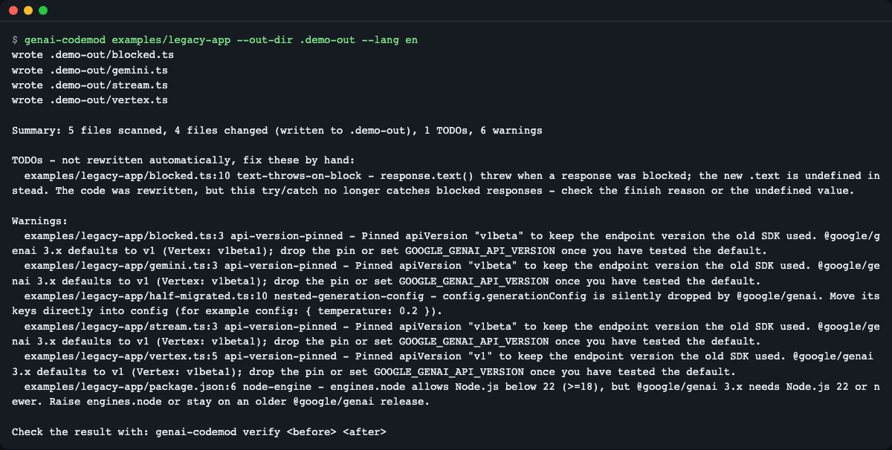
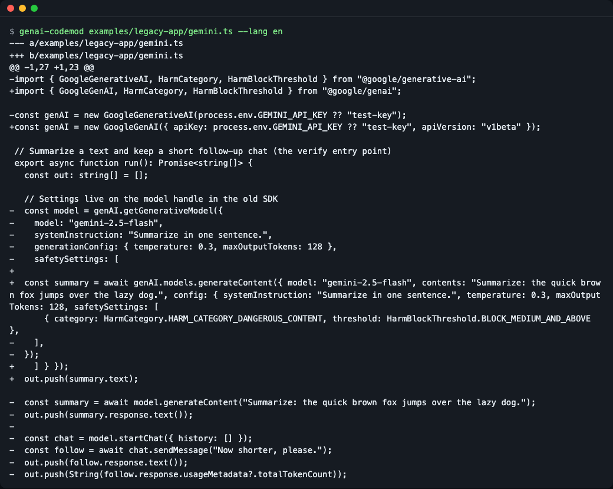
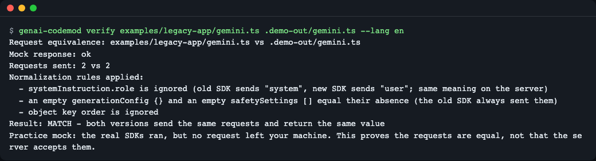
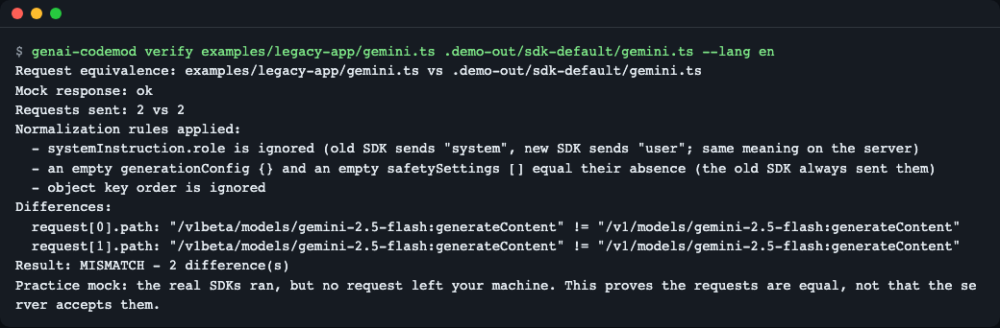
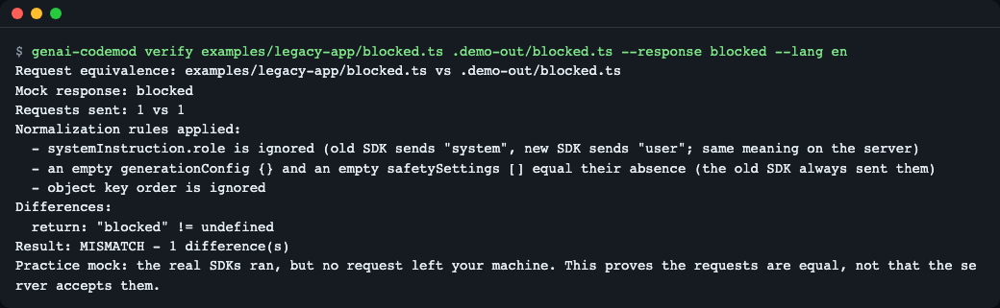
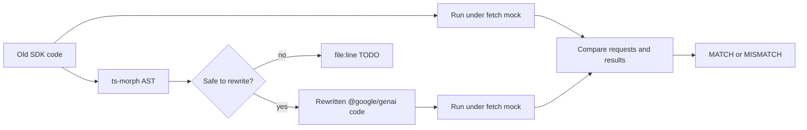

# genai-codemod

**English** | [한국어](README.ko.md)

A codemod CLI that rewrites code written for the end-of-life Gemini JS SDK (`@google/generative-ai`) or the Vertex AI Node SDK (`@google-cloud/vertexai`) to the current `@google/genai` SDK. It then runs both versions under a mocked `fetch` and checks that they send the same API requests, with no API key and no network. It is for Node and TypeScript maintainers who have to move off the old SDKs and want to know what silently changed.


*One command rewrites the whole sample app, lists what it would not guess as `file:line` TODOs, and warns about behavior changes.*

## Before and after

The old SDK keeps settings on a model handle. The new SDK passes the model name and settings with every call, and `response.text()` becomes the `.text` getter.

```ts
// Before: @google/generative-ai
const model = genAI.getGenerativeModel({ model: "gemini-2.5-flash", generationConfig: { temperature: 0.3 } });
const result = await model.generateContent("Name one planet.");
return result.response.text();
```

```ts
// After: @google/genai (output of genai-codemod, unchanged)
const result = await genAI.models.generateContent({ model: "gemini-2.5-flash", contents: "Name one planet.", config: { temperature: 0.3 } });
return result.text;
```

The client line changes too: `new GoogleGenerativeAI(key)` becomes `new GoogleGenAI({ apiKey: key, apiVersion: "v1beta" })`. `verify` ran both versions of this file and printed `MATCH`. The full list of rewrites is in [What gets rewritten](#what-gets-rewritten).

## Who it is for
- You maintain a Node or TypeScript project that still imports `@google/generative-ai` or the generative module of `@google-cloud/vertexai`, and you want the mechanical 90% done for you.
- You migrated by hand (or with a general-purpose tool) and want proof that the requests on the wire did not change.
- You want a list of the spots that need a human decision instead of a rewrite that guesses.

## Install

Needs Node.js 22 or newer and git. Nothing else: the codemod uses ts-morph (pure JavaScript), so a minimal Linux image with `nodejs` and `git` is enough.

```bash
brew install node            # macOS; on Linux use your package manager or https://nodejs.org
git clone https://github.com/LeeGyeongPil/genai-codemod.git
cd genai-codemod
npm install
npm run build
node dist/cli.js --version   # 0.1.2
```

Examples below write `genai-codemod` for `node dist/cli.js`. Run `npm link` once if you want that name on your PATH.

## Quick start

Try it on the bundled sample app. This builds the project, migrates `examples/legacy-app` into `.demo-out/`, and verifies the Gemini and Vertex files. It needs no key and no network after `npm install`.

```bash
npm start
```

Then, on your own project (a dry run: it only prints a diff and writes nothing):

```bash
genai-codemod src/
```


*A dry run prints a unified diff plus a summary. The model handle `model` is gone: its settings moved to each call as `config`.*

How to read the result:
- `Summary` counts files scanned and changed.
- `TODOs` are places the tool did not rewrite because a guess could change behavior. Fix these by hand. Each has a stable code and `file:line`.
- `Warnings` are things that were rewritten but behave differently or need a decision.
- Exit code: `0` clean, `1` TODOs found or requests differ, `2` usage or parse error.

The sample demo follows the output language order described in [Configuration](#configuration): on a Korean-locale machine it prints Korean. Set `GENAI_CODEMOD_LANG=en` to force English.

When the diff looks right, check it before you overwrite anything. Write the result to another folder, compare original and migrated code with `verify`, and only then apply it in place:

```bash
genai-codemod src/ --out-dir migrated/
genai-codemod verify src/service.ts migrated/service.ts
genai-codemod src/ --write
```

`verify` needs both SDKs installed while you compare (`npm install -D @google/generative-ai @google/genai`).

Verifying before `--write` is the easy path. `verify` runs each file in its own folder, so local imports such as `./client.js` are resolved relative to that file (`.ts`, `.tsx`, `.mts` siblings are transpiled). For `--out-dir` output, a sibling that is missing in the output folder is taken from the original folder.

If you already ran `--write` and use git, restore the whole old tree inside the project, not a single file. A lone old file cannot find its local imports, and `verify` stops with exit `2`:

```bash
mkdir old && git archive HEAD src | tar -x -C old
genai-codemod verify old/src/service.ts src/service.ts
rm -r old
```

Keep `old/` inside the project folder so that `node_modules` (both SDKs) is found, and delete it when you are done: otherwise a later `genai-codemod .` would rewrite the old copy too.

Rerunning after `--write` reports `0 files changed` (the codemod is idempotent), but the `text-throws-on-block` TODO stays listed and the command exits `1`: the codemod leaves a `// genai-codemod TODO(text-throws-on-block): ...` comment above the statement, and it keeps reporting until you delete that comment.

## Usage

| Command / option | What it does | Example |
|---|---|---|
| `genai-codemod [paths...]` | Dry run: print a diff and summary. Default path is the current folder | `genai-codemod src/` |
| `--write` | Save the rewrite in place | `genai-codemod src/ --write` |
| `--out-dir <dir>` | Write results to `<dir>`, keep originals | `genai-codemod src/ --out-dir out/` |
| `--report <file>` | JSON report (summary, per-file TODOs and warnings; codes do not depend on language) | `genai-codemod src/ --report r.json` |
| `--api-version keep\|sdk-default` | `keep` (default) pins the endpoint version the old SDK used; `sdk-default` lets `@google/genai` choose | `--api-version sdk-default` |
| `verify <before> <after>` | Run both files under a fetch mock and compare requests and return values | `genai-codemod verify a.ts b.ts` |
| `--entry <name>` | Exported function that `verify` calls (default `run`) | `--entry summarize` |
| `--response ok\|blocked` | Canned API answer for `verify` (default `ok`) | `--response blocked` |
| `--vertex` | Give the entry function a fake auth client (`{ authClient }`) | `genai-codemod verify a.ts b.ts --vertex` |
| `--json` | `verify` result as JSON | `--json` |
| `--lang en\|ko`, `--no-color` | Output language, plain output | `--lang ko` |

### What gets rewritten

`model` below is a handle from `getGenerativeModel`; `ai` is the client variable (the codemod keeps your variable name).

| Old SDK | `@google/genai` |
|---|---|
| `import { GoogleGenerativeAI } from "@google/generative-ai"` (also `require`) | `import { GoogleGenAI } from "@google/genai"` |
| `new GoogleGenerativeAI(key)` | `new GoogleGenAI({ apiKey: key, apiVersion: "v1beta" })` |
| `new VertexAI({ project, location })` | `new GoogleGenAI({ vertexai: true, project, location, apiVersion: "v1" })` |
| `ai.getGenerativeModel({ model, systemInstruction, generationConfig, safetySettings })` | Removed. The model name goes to each call, the settings go flat into each call's `config` |
| `model.generateContent(x)` | `ai.models.generateContent({ model, contents: x, config })` |
| `model.generateContentStream(x)` and `for await (const c of result.stream) c.text()` | `ai.models.generateContentStream({ model, contents: x })` and `for await (const c of result) c.text` |
| `model.startChat({ history })`, `chat.sendMessage(m)` | `ai.chats.create({ model, history, config })`, `chat.sendMessage({ message: m })` |
| `model.countTokens(x)` | `ai.models.countTokens({ model, contents: x })` |
| `model.embedContent(x)`, `e.embedding.values` | `ai.models.embedContent({ model, contents: x })`, `e.embeddings[0].values` |
| `result.response.text()`, `.functionCalls()`, `.candidates`, `.usageMetadata` | `result.text`, `.functionCalls`, `.candidates`, `.usageMetadata` |

The `apiVersion` pin keeps the endpoint version of the old SDK (see [Scenario 2](#scenario-2-the-api-version-changed-silently)). Anything else is left unchanged and reported as one of the TODO codes below.

### Shared clients across files

A common layout creates the client in one module and uses it in another:

```ts
// src/client.ts
export const genAI = new GoogleGenerativeAI("test-key");
// src/service.ts
import { genAI } from "./client.js";
const model = genAI.getGenerativeModel({ model: "gemini-2.5-flash" });
```

Pass the folder, so both files are scanned in the same run. The codemod follows the exported client into the files that import it and rewrites both sides:

```console
$ genai-codemod src --out-dir migrated
wrote migrated/client.ts
wrote migrated/service.ts

Summary: 2 files scanned, 2 files changed (written to migrated), 0 TODOs, 2 warnings
```

`migrated/service.ts` now calls `genAI.models.generateContent({ model: "gemini-2.5-flash", contents: "hello" })` and returns `r.text`, and `genai-codemod verify src/service.ts migrated/service.ts` prints `MATCH`. The `client-shared` warning on `src/client.ts:3` reminds you that importers outside the scanned paths need the same change.

If you scan only one side, nothing is half-migrated in silence. `genai-codemod src/service.ts` reports `cross-module` at `src/service.ts:4` and `genai-codemod src/client.ts` reports `client-exported` at `src/client.ts:3`; both exit `1`.

### What each TODO means

| Code | Why it is not rewritten | Fix by hand |
|---|---|---|
| `dynamic-model-params` | Model parameters are not a plain object literal | Move the options to each call: `ai.models.generateContent({ model, contents, config })` |
| `handle-escapes` | The model handle or a result is passed, returned or stored where the codemod cannot follow it | Pass the model name and config to each call instead |
| `text-throws-on-block` | `response.text()` used to throw on a blocked answer; the new `.text` is `undefined`. Code was rewritten, the `try/catch` no longer fires | Check the finish reason or the `undefined` value |
| `stream-aggregate` | `await r.response` (aggregated stream) does not exist in the new SDK | Collect chunks while iterating, then process the joined result |
| `server-managers` | Cache and file managers from `@google/generative-ai/server` | Use `ai.caches.*` and `ai.files.*` |
| `request-options` | Timeout, `baseUrl` and extra arguments are not carried over | Use `httpOptions` in the `GoogleGenAI` constructor |
| `vertex-function-schema` | Vertex `function_declarations` schemas | Use `functionDeclarations` and the `Type` enum |
| `vertex-preview` | `vertexAI.preview.*` | Use the matching `ai.*` service |
| `unsupported-usage` | A response call the codemod does not know | See the migration guide |
| `unsupported-import-form` | Namespace, default or whole-module import | Import the names you need from `@google/genai` |
| `cross-module` | A name imported from another file is still used with the old SDK, and that file was not scanned in this run, was already migrated, or its client could not be rewritten. Also reported where an exported model handle is imported | Scan both files in one run (pass their folder), or move the calls to `ai.models.*` by hand |
| `client-exported` | A rewritten client is exported, but no scanned file imports it. Its importers would still call `getGenerativeModel()` and break | Scan the importers in the same run, or migrate them by hand |

Warnings have codes too: `api-version-pinned`, `api-version-default-changed`, `vertex-api-version-default-changed`, `nested-generation-config`, `node-engine`, `duplicate-genai` and `client-shared` (an exported client whose scanned importers were handled in the same run).

### Report JSON

`--report r.json` writes (trimmed):

```json
{
  "tool": "genai-codemod",
  "version": "0.1.2",
  "apiVersionMode": "keep",
  "summary": { "filesScanned": 5, "filesChanged": 4, "todos": 1, "warnings": 6 },
  "files": [
    {
      "path": "examples/legacy-app/blocked.ts",
      "changed": true,
      "todos": [{ "line": 10, "column": 12, "code": "text-throws-on-block", "message": "..." }],
      "warnings": [{ "line": 3, "column": 15, "code": "api-version-pinned", "message": "..." }]
    }
  ]
}
```

### Scenario 1: prove the migration kept the requests

`verify` calls the exported function (`run` by default) of both files with the real old and new SDKs, serves a fake response, and compares the requests that would have been sent.

```bash
npm start   # creates .demo-out/ first
genai-codemod verify examples/legacy-app/gemini.ts .demo-out/gemini.ts
```


*Both versions sent 2 requests with the same method, path, key and body after the listed normalization rules, and returned the same value.*

The normalization rules are printed every time, so you can judge them. They only cover differences that mean the same thing on the server (such as `systemInstruction.role`).

### Scenario 2: the API version changed silently

`@google/genai` calls the Gemini API on `v1`, while the old SDK used `v1beta`. By default the codemod pins `apiVersion: "v1beta"` so nothing changes. If you let the SDK choose, `verify` shows the difference:

```bash
genai-codemod examples/legacy-app/gemini.ts --api-version sdk-default --out-dir .demo-out/sdk-default
genai-codemod verify examples/legacy-app/gemini.ts .demo-out/sdk-default/gemini.ts
```


*The request path moved from `/v1beta/...` to `/v1/...`. For Vertex AI the default moves from `v1` to `v1beta1`.*

### Scenario 3: a blocked answer no longer throws

In the old SDK `response.text()` threw when the safety filter blocked an answer, so code wraps it in `try/catch`. In the new SDK `.text` is `undefined` instead. The codemod rewrites the code but reports a `text-throws-on-block` TODO; `verify --response blocked` shows the effect:

```bash
genai-codemod verify examples/legacy-app/blocked.ts .demo-out/blocked.ts --response blocked
```


*The old code returned `"blocked"`, the migrated code returns `undefined`. Check the finish reason instead of catching.*

Another silent change: `config: { generationConfig: { ... } }` in already-migrated code is dropped by `@google/genai`. The codemod warns `nested-generation-config` at the line, and `verify` reports the missing keys.

Sources (checked 2026-11-19): the `@google/genai` default API versions (`v1` for the Gemini API since 3.0.0, `v1beta1` for Vertex AI) and the Node 22 requirement come from the [js-genai releases](https://github.com/googleapis/js-genai/releases); the behavior changes (`text()` throwing on a blocked answer in the old SDK, flattened config) are described in the [migration guide](https://ai.google.dev/gemini-api/docs/migrate). The tool reproduces them by running the real SDKs, see `test/verify.test.ts`.

## Configuration

| Name | Default | Meaning |
|---|---|---|
| `--lang en\|ko` | from environment | Output language, highest priority |
| `GENAI_CODEMOD_LANG` | unset | `en` or `ko`, used when `--lang` is absent |
| `LC_ALL`, `LC_MESSAGES`, `LANG` | system | `ko_*` selects Korean, anything else English |

No API key is needed. `verify` is a practice mock: the real SDKs run, but their `fetch` is replaced, so no request leaves your machine. It proves requests are equal, not that the server accepts the model or API version. It also executes the entry function of your files, so use it on code you trust.

## How it works



- The codemod parses each file into an AST (a tree of the code's structure) with ts-morph and tracks which variables hold a model handle from `getGenerativeModel`.
- Calls on a handle are moved to `client.models.*` or `client.chats.*`, with the handle's settings flattened into each call's `config`.
- If a file exports an old client, a second pass resolves relative imports (`./client.js`, no extension, folder `index`, `require`) to the scanned files and follows the client into the importers.
- Anything it cannot follow with certainty (spread arguments, handles passed around, `requestOptions`) is left as it was and reported.
- `verify` runs the original and migrated entry function with the real SDKs, intercepts `fetch`, normalizes harmless differences and compares count, method, path, key, body and return value.

## When to use it
- Good fit: Node or TypeScript code on `@google/generative-ai` or `@google-cloud/vertexai` that you want to move to `@google/genai` with a reviewable diff and a request-level check.
- Other tools fit better when: your code is not Node or TypeScript (this tool does not handle other languages); or you only want to read about the new SDK, see [`@google/genai` on GitHub](https://github.com/googleapis/js-genai) and the [migration guide](https://ai.google.dev/gemini-api/docs/migrate).

## Limitations and roadmap

Known limits in 0.1.2:
- Shared clients are followed only between files scanned in the same run. Re-exports (`export { genAI } from "./client"`) and namespace imports (`import * as c`) are not followed. Importers outside the scanned paths cannot be seen: the `client-shared` warning reminds you, and a `client-exported` TODO appears when no scanned file imports the client.
- Exported model handles (`export const model = genAI.getGenerativeModel(...)`) are not moved: `handle-escapes` where defined, `cross-module` where imported. Clients or chats stored in class fields are reported as TODOs, not tracked.
- Request-object calls such as `generateContent({ contents })` and `embedContent({ content, taskType })` are reported as `dynamic-model-params`.
- `embedContent` is rewritten, but the new SDK calls `:batchEmbedContents`, so `verify` reports a path and body difference there on purpose.
- `verify` resolves local imports relative to each file; an old copy needs its whole tree (see [Quick start](#quick-start)). Local imports of `.json` or other non-JS/TS files get no special handling.
- Vertex code whose entry function does not accept an auth client argument cannot be verified.
- The mock proves the requests are equal, not that the server supports the model or API version. `verify` executes your entry function.
- An entry function whose promise never settles has no `verify` time limit, and Ctrl+C then can leave a temporary `.genai-codemod-*.mjs` file next to your source.
- Output can contain long one-line objects; run Prettier afterwards.

Planned next: Vertex function declaration schemas (`function_declarations` to `functionDeclarations`, the `Type` enum), cache and file manager rewrites, an automatic fix for nested `generationConfig`, and a token-endpoint mock so Vertex code can be verified without an auth client argument. A Python version (`google-generativeai` to `google-genai`) is out of scope for now.

## Troubleshooting

| Symptom | Cause | Fix |
|---|---|---|
| Node version error at start, or a `node-engine` warning | This tool and `@google/genai` 3.x need Node 22+ | Upgrade Node and raise `engines.node` |
| Exit code 1 after a clean-looking run | There are TODOs, or `verify` found differences | Read the `TODOs` list and `Differences` |
| `Path not found` (exit 2) | Wrong path argument | Check the path |
| `does not export an async function named "run"` | The entry function is missing or has another name | Export an async function, or pass `--entry <name>` |
| Vertex `verify` fails to authenticate | The entry function does not accept `{ authClient }` | Accept an auth client argument and pass `--vertex` |
| Rerun says `0 files changed` but still exits `1` | Already migrated (idempotent), but a `genai-codemod TODO(text-throws-on-block)` comment is still in the code | Handle the blocked case, then delete the comment |
| `Could not load "@google/generative-ai"` in `verify` | The old SDK is not installed | `npm install -D @google/generative-ai @google/genai` |
| `verify` needs both SDKs | Both old and new packages must be installed while you compare | Keep both as devDependencies until you are done |
| `old/service.ts imports ./client.js, which was not found next to it` (exit 2) | A single old file was copied out of its folder, so its local imports are missing | Restore the whole tree: `mkdir old && git archive HEAD src \| tar -x -C old`, then `verify old/src/service.ts src/service.ts` |
| `cross-module` TODO in a file that imports a client | The file that creates the client was not scanned in the same run, or was already rewritten by an earlier `--write` | Pass the folder that holds both files; if one side is already migrated, move the remaining calls by hand |

## Development

```bash
npm install
npm test
```

Report bugs and ideas as issues. Changes are listed in [CHANGELOG.md](CHANGELOG.md).

## License

MIT.
